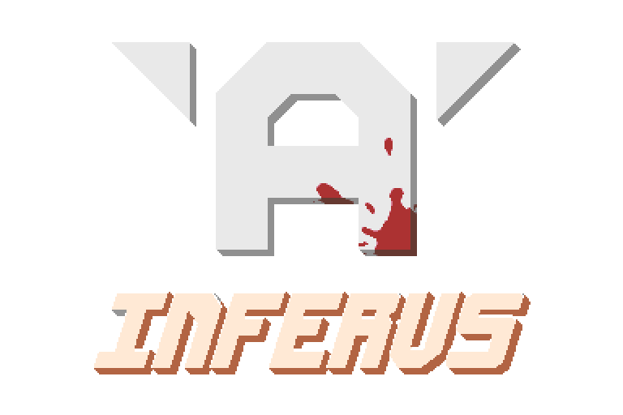

<p align="center"> </p></div>

Inferus is an open source adult-oriented project aimed at creating unique gameplay and a pleasant roleplaying atmosphere in the game Space Station 14.


## Links

<div class="header" align="center">

Inferus

[Discord](https://discord.gg/9Gyj2YNf6z) | [crouton](https://crouton.net/)

Space Station 14

[GitHub](https://github.com/space-wizards/space-station-14) | [Website](https://spacestation14.com/) | [Discord](https://discord.ss14.io/)

</div>

## Documentation/Wiki

SS14's [docs site](https://docs.spacestation14.com/) has documentation on SS14's content, engine, game design, and more.
Additionally, see these resources for license and attribution information:
- [Robust Generic Attribution](https://docs.spacestation14.com/en/specifications/robust-generic-attribution.html)
- [Robust Station Image](https://docs.spacestation14.com/en/specifications/robust-station-image.html)

## Contributing

We are happy to accept contributions from anybody. We've got a [list of issues](https://github.com/MoffiaDev/Inferus/issues) that need to be done and anybody can pick them up. Don't be afraid to ask for help either!
Just make sure your changes and pull requests are in accordance with the [Contributing Guidelines](https://github.com/MoffiaDev/Inferus/blob/master/CONTRIBUTING.md).

We are not currently accepting translations of the game on our main repository. If you would like to translate the game into another language, consider creating a fork or contributing to a fork.

## AI-generated contributions disclaimer
Please refer to our [Contributing Guidelines](https://github.com/MoffiaDev/Inferus/blob/master/CONTRIBUTING.md) for more information.

## Building

1. Clone this repo:
```shell
git clone https://github.com/MoffiaDev/Inferus.git
```
2. Go to the project folder and run `RUN_THIS.py` to initialize the submodules and load the engine:
```shell
cd Inferus
python RUN_THIS.py
```
3. Compile the solution:

Build the server using `dotnet build`.

[More detailed instructions on building the project.](https://docs.spacestation14.com/en/general-development/setup.html)

## License

Please see [LEGAL.md](https://github.com/MoffiaDev/Inferus/blob/master/LEGAL.md) for licensing information.

Most assets are licensed under [CC-BY-SA 3.0](https://creativecommons.org/licenses/by-sa/3.0/) unless stated otherwise. Assets have their license and copyright specified in the metadata file. For example, see the [metadata for a crowbar](https://github.com/space-wizards/space-station-14/blob/master/Resources/Textures/Objects/Tools/crowbar.rsi/meta.json).

Code taken from [Project Starlight](https://github.com/ss14Starlight/space-station-14) was taken in accordance with the [Starlight License](./LICENSE-Starlight.txt).

> Some assets are licensed under the non-commercial [CC-BY-NC-SA 3.0](https://creativecommons.org/licenses/by-nc-sa/3.0/) or similar non-commercial licenses and will need to be removed if you wish to use this project commercially.
